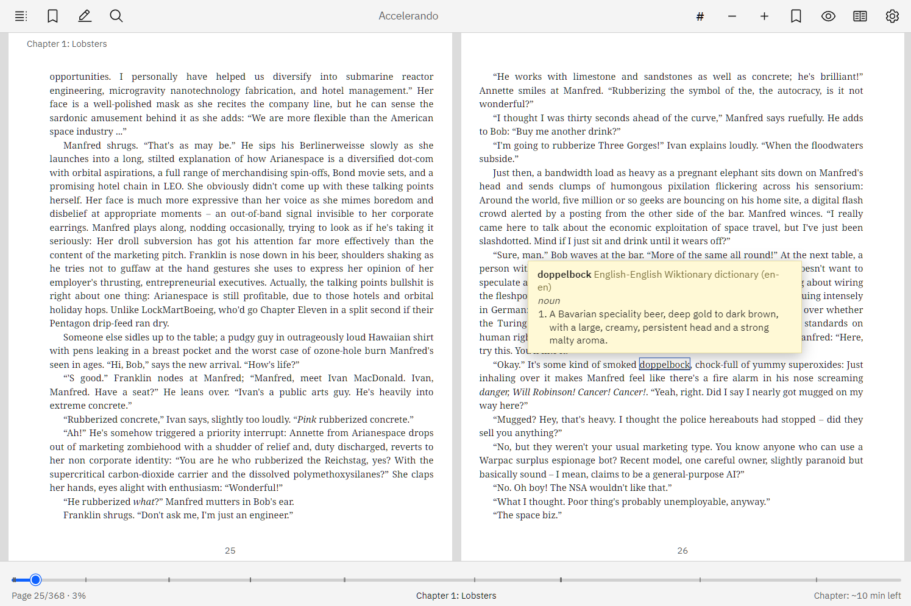

# Bowser's Epub Reader

A simple epub reader written in Tauri + Svelte + epub.js + Rust/SQLite.



**Download:** [https://github.com/Bowserinator/bowsers-epub-reader/releases](https://github.com/Bowserinator/bowsers-epub-reader/releases)

# Features

- All usual styles (dark/light/etc...), font selection, font-size, line-spacing, page margin, text alignment, chapter headings and page numbers on page, page flow (single / double page / etc...), page gap styles
- Styles can be overriden per book or globally
- Import StarDict dictionaries and hover to define words (configable)
- Reading speed estimate (for chapter/book/etc..., right click bottom-right label below the progress bar to cycle)
- Highlights and bookmarks saved per book
- Remembers window size, position and monitor (falls back to the primary monitor if it is gone)
- Search text with regex + case-insensitive options

# Controls

- `Left/Right, Space/Shift-Space, PageUp,PgDwn, Scroll, Click left/right margin`: change page
- `Home/End`: Start/end of book
- `Ctrl-F`: Search (with regex + case-sensitive options)
- `Ctrl-,`: Settings
- `Ctrl-B`: Bookmark page
- `Ctrl-Z`: Undo last bookmark or highlight change (up to 10)
- `Ctrl-=, Ctrl--, Ctrl-O`: Font-size changes
- `Ctrl-G`: Goto page
- `Ctrl-H`: Toggle toolbar autohide
- `Alt-Left/Alt-Right`: Back / forward in reading history (up to 10 each)
- `?`: Open shortcuts help page

## Running

```
bowsers_epub_reader [book.epub]
```

Without an argument, it will prompt you to open a book.

## Development dependencies

Tauri links against the system WebKitGTK and GTK libraries.

Common tools (all platforms): [Rust](https://rustup.rs) (stable, 1.77+), Node.js 20+, and [pnpm](https://pnpm.io/installation).

**Debian / Ubuntu**
```
sudo apt update
sudo apt install build-essential curl wget file pkg-config libssl-dev libxdo-dev \
  libwebkit2gtk-4.1-dev libayatana-appindicator3-dev librsvg2-dev libfontconfig1-dev
```

**Fedora**
```
sudo dnf group install "c-development"
sudo dnf install webkit2gtk4.1-devel openssl-devel curl wget file libxdo-devel \
  libappindicator-gtk3-devel librsvg2-devel fontconfig-devel
```

**Arch**
```
sudo pacman -S --needed base-devel webkit2gtk-4.1 curl wget file openssl xdotool \
  libappindicator-gtk3 librsvg fontconfig
```

**Windows**: install the Visual Studio C++ Build Tools (Desktop development with C++), Rust (MSVC toolchain), Node.js and pnpm. The WebView2 runtime ships with Windows 11 and current Windows 10. Run the commands below from Git Bash.

Extra tools for specific packages: `rpm` (RPM bundles), `flatpak` and `flatpak-builder` (Flatpak)

## Build

```
pnpm install
pnpm test                    # frontend unit tests
(cd src-tauri && cargo test) # backend unit tests
pnpm tauri dev               # run with hot reload
```

| Output | Command | Result |
|---|---|---|
| Standalone binary | `pnpm tauri build --no-bundle` | `src-tauri/target/release/bowsers_epub_reader` (needs WebKitGTK installed on the target) |
| Debian package | `scripts/build.sh deb` | `src-tauri/target/release/bundle/deb/` |
| RPM package | `scripts/build.sh rpm` | `src-tauri/target/release/bundle/rpm/` |
| Flatpak | `scripts/build.sh flatpak` | `release/flatpak/bowsers-epub-reader.flatpak` |
| All Linux packages | `scripts/build.sh linux-all` | deb, rpm and flatpak |
| Windows installer | `scripts/build.sh windows` | `src-tauri/target/release/bundle/nsis/` |
| Windows portable | `scripts/build.sh windows-portable` | `release/windows-portable/` |

`scripts/build.sh auto` picks deb, rpm or the Windows installer for the current system. Set `SKIP_CHECKS=1` to skip tests and lint.

## Debugging

To run a debug build, which includes the web inspector: `pnpm tauri dev` or `pnpm tauri build --debug`.
